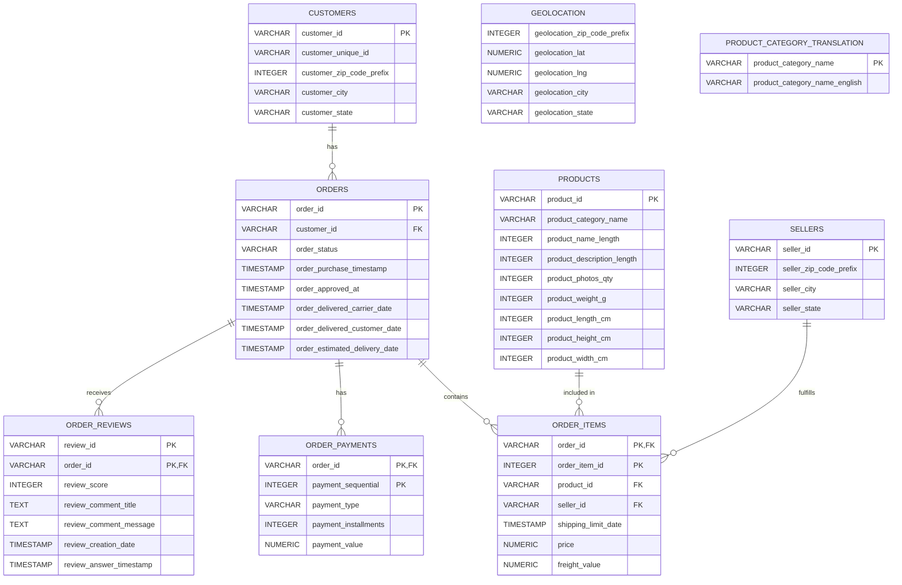

# Olist Brazilian E-Commerce | End-to-End SQL & Power BI Analytics

**PostgreSQL · SQL · Data validation · Power BI · DAX · Business intelligence**

An end-to-end portfolio project using the [Brazilian E-Commerce Public Dataset by Olist](https://www.kaggle.com/datasets/olistbr/brazilian-ecommerce). The project connects relational data exploration and validation in PostgreSQL with an interactive three-page Power BI dashboard to investigate sales, customer retention, fulfilment, product categories and sellers.

> **Scope:** Descriptive and diagnostic analysis of historical transactions (2016–2018). Revenue is merchandise value based on `order_items.price`, excluding freight. This project does **not** estimate profit or establish causal relationships.

## Executive Summary

- **$13,591,643.70** in recorded merchandise revenue across the item-based analysis.
- **99,441** records/orders in the SQL source `orders` table versus **98,666 distinct order IDs** represented in the Power BI `FactSales` view. These are different analytical populations; see [Metric reconciliation](#metric-reconciliation-sql-versus-power-bi).
- **96,096 unique customer identities**, including **2,997** classified as repeat customers in the SQL customer analysis.
- Among **96,476** delivered orders classified against the estimated delivery date, **88,649** were on time and **7,827** late; their average review scores were **4.29** and **2.57**, respectively. This is an association, not proof of causation.
- The Power BI report explores category revenue concentration, volume-versus-value growth, freight exposure and seller performance through interactive filters and bookmark-driven detail views.

**Business objective:** Turn transaction-level records into reproducible metrics, identify commercial and operational questions worth investigating, and propose measurable next steps rather than treating correlations or revenue rankings as proof of business impact.

## End-to-End Workflow

1. **Data source:** Olist public CSV tables, approximately 100,000 orders over 2016–2018; raw CSV files are not redistributed here.
2. **PostgreSQL:** Create relational tables and validate record counts, uniqueness and relationships.
3. **SQL business analysis:** Explore sales, customer identity, categories, sellers, geography, delivery and reviews.
4. **Power BI:** Prepare an item-grain fact table, dimensions, relationships and DAX metrics.
5. **Decision support:** Explore three dashboard pages and translate findings into hypotheses, recommendations and measurement plans.

## Dashboard Gallery

### Performance Overview


### Sales Performance & Growth — VISUALS ON


### Sales Performance & Growth — DETAILS ON


### Seller Performance


### Power BI Semantic Model


> The screenshots supplied during development show growth KPI values that still require validation against comparable prior-year date windows. Do not interpret those displayed YoY values as verified findings until the Power BI measures and images are refreshed.


## Business Questions

The analysis explores questions such as:

### Sales Performance
- What is the total revenue?
- How many orders were placed?
- What is the average order value?
- How does revenue change over time?
- Which product categories generate the most revenue?

### Customer Behaviour
- How many unique customers are there?
- How many customers made repeat purchases?
- What proportion of customers are one-time versus repeat customers?
- How does revenue differ between customer types?

### Product & Seller Performance
- Which products generate the most revenue?
- Which sellers generate the most revenue?
- Which sellers have relatively high order volume but low revenue?
- Which products perform best within each category?

### Geographic Performance
- Which Brazilian states generate the most revenue?
- Which states have the highest number of late deliveries?

### Delivery & Customer Experience
- What is the average delivery time?
- How many orders were delivered late?
- How does delivery performance relate to customer review scores?

## SQL Techniques Used

This project demonstrates practical SQL techniques including:

- `SELECT`
- `WHERE`
- `ORDER BY`
- `GROUP BY`
- `HAVING`
- `INNER JOIN`
- `LEFT JOIN`
- Aggregate functions such as `SUM`, `COUNT`, and `AVG`
- `COUNT(DISTINCT ...)`
- `CASE WHEN`
- Date functions
- Subqueries
- Common Table Expressions (CTEs)
- Window functions
- `ROW_NUMBER()`
- Revenue contribution calculations
- Data validation and referential integrity checks

## Database Structure

The PostgreSQL database contains nine main tables.



The database was designed using primary keys and foreign keys where appropriate.

The `order_items` table uses a composite primary key of `(order_id, order_item_id)`.

The `order_payments` table uses a composite primary key of `(order_id, payment_sequential)`.

The `order_reviews` table uses a composite primary key of `(review_id, order_id)` based on the structure of the source data.

The `geolocation` and `product_category_translation` tables are included in the database but do not currently have direct foreign key relationships to other tables.

## SQL Findings and Evidence

The analysis identified several patterns across sales performance, customer behaviour, seller activity, and delivery outcomes.

### Sales Performance

- The source `orders` table contains **99,441 order records**; the item-based analysis generates approximately **13.59M in product revenue**, based on item prices and excluding freight charges.
- The item-based average order value is approximately **137.75**, calculated as merchandise revenue divided by distinct orders with items (98,666 in the Power BI fact table).
- Revenue varies substantially across product categories, with a relatively small number of categories contributing a large share of overall product revenue.
- Monthly revenue analysis shows changes in sales activity over the observation period, providing a basis for identifying periods of stronger and weaker commercial performance.

### Customer Behaviour

- The dataset contains **96,096 unique customer identities**.
- **2,997 customer identities** are associated with more than one customer record/order, while **93,099** appear as one-time customers.
- This indicates that the dataset is characterised primarily by one-time purchasing behaviour, highlighting the potential importance of customer retention and repeat-purchase strategies.
- Revenue analysis by customer type shows that one-time customers account for approximately **94.27% of product revenue**, while repeat customers account for approximately **5.73%**.
- Customer-level analysis uses `customer_unique_id` to distinguish customer identities from the `customer_id` records associated with individual orders.

### Delivery Performance

- Among orders with recorded customer delivery dates, **88,649 were delivered on time and 7,827 were delivered after the estimated delivery date**.
- The analysis therefore covers **96,476 delivered orders** with sufficient information to classify delivery performance. Orders without a recorded customer delivery date are excluded from this comparison.
- Average delivery time from purchase to customer delivery was approximately **12.5 days**.
- Late delivery patterns were also examined by customer state to identify geographic differences in delivery performance.

### Customer Reviews and Delivery

- Orders delivered on time received an average review score of approximately **4.29**, compared with **2.57** for orders classified as late.
- This shows a clear **association between delivery performance and review scores within the dataset**.
- The analysis does not establish that late delivery directly causes lower review scores, as other factors may also influence customer satisfaction.

### Product and Category Performance

- Product-level analysis identifies the highest-revenue products and the top revenue-generating products within each product category.
- Category-level analysis compares both revenue contribution and average revenue per order containing each category.
- Product categories were also compared based on their associated average review scores. Because Olist reviews are recorded at the order level, these results should be interpreted as **average review scores for orders associated with a category**, rather than direct product-level satisfaction scores.
- Revenue contribution analysis provides a view of how individual product categories contribute to total product revenue.

### Seller Performance

- Seller-level analysis identifies the highest-revenue sellers based on product sales.
- A separate analysis examines sellers with relatively high order volumes but lower total product revenue, providing a way to identify sellers whose sales volume and revenue generation differ substantially.

### Business Implications

The findings provide several areas for further business investigation:

1. **Customer retention:** The high proportion of one-time customers suggests that repeat-purchase behaviour is an important area for further analysis.
2. **Delivery performance:** The difference in review scores between late and on-time orders indicates that delivery performance is closely associated with the customer experience in this dataset.
3. **Category concentration:** Revenue contribution analysis can help identify categories that represent a substantial proportion of overall sales.
4. **Seller performance:** Comparing order volume with revenue can highlight differences in seller sales profiles and potential opportunities for further investigation.
5. **Geographic performance:** Customer-state and delivery analysis can support further investigation of regional differences in sales and fulfilment outcomes.

### Analytical Notes and Limitations

- **Revenue definition:** Revenue in this project refers to the `price` field from `order_items` and therefore excludes freight charges.
- **Customer definition:** `customer_unique_id` is used when analysing unique customer identities, while `customer_id` represents the customer record associated with an order.
- **Delivery analysis:** On-time and late delivery comparisons include only orders with a recorded customer delivery date.
- **Review analysis:** Olist reviews are associated with orders rather than individual order items. Category-level review analysis therefore uses distinct order-category combinations to avoid artificially duplicating review records when an order contains multiple items.
- **Association vs causation:** Relationships between delivery performance and review scores are observational associations and should not be interpreted as causal effects.
- **Product categories:** The source dataset contains two product categories without English translations. The original category names are retained rather than manually assigning translations.
- **Historical dataset:** The analysis is based on the Olist Brazilian E-Commerce Public Dataset and reflects the period covered by the source data rather than current e-commerce performance.

## Selected SQL Analysis Results

The SQL analysis was used to investigate several business areas, including sales performance, customer behaviour, delivery performance, and customer satisfaction.

### Sales Performance

| Metric | Result |
|---|---:|
| Source `orders` records | 99,441 |
| Unique customers | 96,096 |
| Total product revenue | 13.59M |
| Average order value | 137.75 |

### Customer Behaviour

| Metric | Result |
|---|---:|
| One-time customers | 93,099 |
| Repeat customers | 2,997 |
| One-time customer share | 96.9% |
| Repeat customer share | 3.1% |

### Delivery Performance

| Delivery status | Orders |
|---|---:|
| On time | 88,649 |
| Late | 7,827 |

Average delivery time was approximately **12.5 days** among orders with a recorded customer delivery date.

### Customer Reviews

| Delivery status | Average review score |
|---|---:|
| On time | 4.29 |
| Late | 2.57 |

The results show a substantial difference in average review scores between orders delivered on time and orders delivered late. This represents an observed association in the dataset rather than evidence of a causal relationship.

## Power BI Dashboard: Design and Business Questions

## Report navigation and interactive design

| Page | Core decision | Verified visuals and features |
|---|---|---|
| **1. Performance Overview** | Where is revenue and order activity concentrated? | Revenue, orders, AOV and revenue-growth KPI cards; monthly revenue trend; Top 10 Categories by Revenue; Top 10 States by Revenue; slicers. |
| **2. Sales Performance & Growth** | Which categories merit growth or operational investigation? | Revenue Growth YoY, Order Growth %, AOV Growth %, Freight Ratio; Total Orders by Category; Top 20 Category Growth Drivers; Revenue vs Freight Cost Exposure; **Category Opportunity Matrix**; **category detail pivot table**; **DETAILS ON / VISUALS ON bookmark buttons**. |
| **3. Seller Performance** | Which sellers contribute revenue versus order volume? | Seller KPI cards; Top 20 Sellers by Revenue; Top 20 Sellers by Order Volume; Seller Volume vs Value; slicers. |

### The Page 2 details workflow

The report uses two bookmark-linked buttons, **DETAILS ON** and **VISUALS ON**, to switch between an analytical chart view and a detailed category table **within the same page**. The category detail table includes **Product Category, Total Orders, Total Revenue, Average Order Value and Average Product Price**.

**Why this matters:** Decision-makers can first identify an unusual category on the scatter/bar/combo visuals, then inspect its underlying commercial metrics without leaving the analysis context. This reduces dependence on isolated headline percentages and supports more transparent prioritisation.

**Suggested user journey:** Identify a category in *Category Opportunity Matrix* → select or filter the category → click **DETAILS ON** → review its revenue, orders, AOV and average product price → return via **VISUALS ON** → compare its order/AOV growth and freight exposure → flag it for investigation.

*Implementation check:* Confirm bookmark settings preserve the intended slicer and selection state. If a bookmark resets filters, adjust bookmark **Data** settings or document the reset behavior.

---

## Page 1 — Performance Overview

### KPI cards: Total Revenue, Total Orders, Average Order Value, Revenue Growth

- **Purpose:** Provide a compact baseline of sales scale, transaction volume, basket value and reported growth.
- **Business interpretation:** Revenue can increase through more orders, higher AOV or both; the cards should be read together rather than independently.
- **Impact:** Enables a manager to distinguish scale from order economics before drilling into category or seller performance.
- **Recommendation:** Track changes in both orders and AOV and investigate large divergences. **Do not interpret a partial-year YoY comparison as full-year growth.**
- **Implementation:** Use a consistent definition of revenue (typically order-item `price`, excluding freight), `DISTINCTCOUNT(order_id)` for orders, and AOV = Revenue / Orders. Recalculate YoY on comparable windows.

### Monthly Revenue Trend — line chart

- **Purpose:** Identify changes in sales activity over time, including peaks, troughs and possible seasonality.
- **What to inspect:** Month-to-month movement, whether spikes recur, and whether the apparent trend is distorted by incomplete beginning/end periods.
- **Business impact:** Helps plan further analysis of promotions, supply capacity and fulfilment demand.
- **Recommendation:** Investigate significant peaks with product mix, order volume and campaign information rather than assuming they were caused by marketing.
- **Implementation:** Use a continuous date dimension, consistent month ordering and explicit annotations for partial months.

### Top 10 Categories by Revenue — horizontal bar chart

- **Purpose:** Rank the largest revenue-contributing product categories.
- **What to inspect:** Revenue concentration and the gap between leading and lower-ranked categories.
- **Business impact:** Highlights where commercial exposure is concentrated and which categories deserve closer performance monitoring.
- **Recommendation:** For high-revenue categories, review growth, delivery performance and freight exposure before making investment decisions.
- **Implementation:** Sort by revenue descending; keep a stable Top 10 definition; show revenue share in tooltips if available.
- **Caveat:** Revenue leadership is **not** evidence of profit leadership.

### Top 10 States by Revenue — column chart

- **Purpose:** Show geographic concentration of customer revenue.
- **What to inspect:** Leading customer states and differences in demand concentration.
- **Business impact:** Provides a starting point for geographic segmentation and logistics capacity discussions.
- **Recommendation:** Compare demand concentration with delivery time, freight burden and seller locations before considering geographic expansion or service changes.
- **Implementation:** Confirm the state field refers to **customer state**, not seller state, and that geographic comparisons use consistent filters.

---

## Page 2 — Sales Performance & Growth

### KPI cards: Revenue Growth YoY, Order Growth %, AOV Growth %, Freight Ratio

- **Purpose:** Separate changes in sales scale, transaction volume, order value and shipping-related exposure.
- **Interpretation:** High order growth combined with flat/negative AOV growth may suggest volume-led expansion; the freight ratio highlights freight value relative to merchandise revenue.
- **Business impact:** Gives commercial and operations teams a common starting point for discussing the quality and composition of growth.
- **Recommendation:** Reconcile all growth KPIs to **the same comparable period**. Use freight ratio as an investigation signal, not a profit margin.
- **Implementation:** Validate year filters and DAX date context. The 2018 data ends in early September; a full-2017-versus-partial-2018 comparison is not like-for-like.

### Total Orders by Category — clustered bar chart

- **Purpose:** Identify the product categories generating the greatest distinct order activity.
- **Interpretation:** A category can have high order volume without ranking equally highly by revenue; the difference invites examination of AOV and product price.
- **Business impact:** Supports demand and fulfilment prioritisation, especially where operational load is linked to order count.
- **Recommendation:** Compare high-volume categories with AOV, revenue and delivery indicators before adjusting stock or fulfilment processes.
- **Implementation:** Use distinct order count at category grain. An order containing multiple categories can count once **in each category**; therefore category-level orders need not sum to the overall distinct order count.

### Top 20 Category Growth Drivers — scatter chart

- **Fields confirmed in report:** Product category, Order Growth %, AOV Growth %, Total Revenue.
- **Purpose:** Examine whether changes in category performance are primarily associated with order volume, average order value, or opposing movements in both.
- **Interpretation:** Four zones: orders up/AOV up; orders up/AOV down; orders down/AOV up; orders down/AOV down. Bubble size can provide revenue context.
- **Business impact:** Helps distinguish potential demand expansion from shifts in order value, guiding follow-up questions for merchandising and marketing.
- **Recommendation:** Prioritise commercially material categories, then test whether promotions, price/product mix or repeat purchasing might explain the pattern.
- **Implementation:** Validate Top 20 filter basis (prefer Top 20 by revenue if that is the intended scope); add zero reference lines; compare matching prior-year windows; suppress or flag categories with very small comparison bases.
- **Caveat:** Changes in AOV do not establish price changes or customer behaviour without further data.

### Revenue vs Freight Cost Exposure — line and stacked column combo chart

- **Fields confirmed in report:** Product category, Total Revenue, Freight Ratio.
- **Purpose:** Compare category revenue scale (columns) with relative freight exposure (line), rather than treating freight as a direct measure of profitability.
- **Interpretation:** High-revenue categories with elevated freight ratio may be commercially important candidates for logistics investigation. Small categories with high freight ratio may reflect different product sizes, routes or order mix.
- **Business impact:** Helps direct operational analysis to categories where freight exposure and sales scale warrant attention.
- **Recommendation:** Drill into product dimensions/weight, delivery distance, seller location and carrier arrangements before proposing freight optimisation.
- **Implementation:** Use clearly labelled **separate currency and percentage axes**; define `Freight Ratio = SUM(freight_value) / Total Revenue`; make category sorting and dual-axis scales explicit.
- **Caveat:** Freight value in the public dataset is not a full cost-to-serve model; it may represent shipping charges recorded on orders rather than the merchant's actual incurred logistics cost. Do not equate the ratio with margin erosion without validating the economic interpretation.

### Category Opportunity Matrix — scatter chart **on Page 2**

- **Fields confirmed in report:** Product category, Total Revenue, Revenue Contribution %, Revenue Growth YoY.
- **Purpose:** Assess categories jointly by their importance to the revenue base and their growth profile.
- **Interpretation:** High contribution/high growth = investigate expansion; high contribution/low growth = protect and diagnose; low contribution/high growth = test scalability; low contribution/low growth = monitor and review resource allocation.
- **Business impact:** Creates a repeatable prioritisation framework rather than ranking solely by sales or percentage growth.
- **Recommendation:** Treat quadrant labels as **decision prompts**. Validate absolute revenue gain, base sizes, freight exposure, delivery performance and commercial feasibility before making investment decisions.
- **Implementation:** Use contribution as a percentage of the appropriate selected revenue total; calculate growth on comparable periods; apply reference lines consistently; handle blank/very-low-base categories transparently.
- **Caveat:** This matrix does **not** identify the most profitable categories.

### Category Details Table — bookmark-controlled pivot table

- **Fields confirmed in report:** Product Category, Total Orders, Total Revenue, Average Order Value, Average Product Price.
- **Purpose:** Verify and contextualise category patterns identified in the charts with actual supporting metrics.
- **Interpretation:** High revenue may result from many orders, larger orders, or product mix. AOV and average product price are **different** metrics: AOV is revenue per distinct order; average product price is an item-level average, subject to its DAX definition.
- **Business impact:** Makes exploratory analysis auditable and supports evidence-based discussions rather than relying only on visual position.
- **Recommendation:** When a category looks unusually strong or weak, inspect all five fields before assigning a priority.
- **Implementation:** Use **DETAILS ON** to show the table and **VISUALS ON** to return to charts. Verify bookmark interaction with slicers, cross-highlighting and report filters. Add conditional formatting sparingly.
- **Caveat:** Do not sum category-level distinct orders to infer the unique order total if multi-category orders are possible.

---

## Page 3 — Seller Performance

### Seller KPI cards

- **Purpose:** Summarise the seller population and the typical revenue/order-value profile, subject to the specific measures configured in the PBIX.
- **Business impact:** Establish a baseline for understanding seller contribution and heterogeneity.
- **Implementation:** Verify whether average revenue per seller is total revenue divided by distinct sellers and whether seller AOV is weighted or an unweighted average of seller-level AOVs; these are not interchangeable.

### Top 20 Sellers by Revenue — horizontal bar chart

- **Purpose:** Rank sellers by merchandise revenue contribution.
- **Business impact:** Helps identify major revenue relationships and concentration risk.
- **Recommendation:** Review top sellers for operational reliability and dependency risk; do not assume high revenue means high margin.
- **Implementation:** Keep a consistent seller identifier, filters and Top 20 rule.

### Top 20 Sellers by Order Volume — horizontal bar chart

- **Purpose:** Rank sellers by distinct orders handled.
- **Business impact:** Identifies sellers generating substantial transaction and fulfilment workload, which may differ from revenue leaders.
- **Recommendation:** Compare order-volume leaders with revenue, AOV and delivery outcomes.
- **Implementation:** Use `DISTINCTCOUNT(order_id)` in seller context, not item-row count.

### Seller Volume vs Value — scatter chart

- **Purpose:** Compare sellers on order volume and revenue to identify different operating profiles.
- **Interpretation:** High orders/high revenue; high orders/lower revenue; fewer orders/high revenue; fewer orders/lower revenue. These are relative segments, not fixed performance grades.
- **Business impact:** Supports targeted seller-management questions, such as fulfilment support for high-volume sellers or product-mix investigation for high-value sellers.
- **Recommendation:** Review seller category mix and fulfilment metrics before proposing incentives or interventions.
- **Implementation:** Add clear median/reference lines if appropriate, and document whether the plotted sellers are filtered to Top N or the full population.

---

## Verified category findings — unfiltered category detail view

The following observations were read from the **DETAILS ON** screenshot with no year/category selection visibly applied. They describe the historical dataset view, **not** a comparable-period growth result.

| Category (source label) | Merchandise revenue | Distinct category orders | Category AOV |
|---|---:|---:|---:|
| `beleza_saude` (Health & Beauty) | $1,258,681.34 | 8,836 | $142.45 |
| `relogios_presentes` (Watches & Gifts) | $1,205,005.68 | 5,624 | $214.26 |
| `cama_mesa_banho` (Bed, Bath & Table) | $1,036,988.68 | 9,417 | $110.12 |
| `esporte_lazer` (Sports & Leisure) | $988,048.97 | 7,720 | $127.99 |
| `informatica_acessorios` (Computers & Accessories) | $911,954.32 | 6,689 | $136.34 |

**Finding 1 — Revenue concentration.** The five leading categories represent **approximately 39.7%** of the $13,591,643.70 merchandise revenue shown in the table. **Decision use:** monitor these categories as material contributors and investigate changes in their order volume, AOV and comparable-period growth. **Implementation:** maintain a monthly category scorecard and flag material shifts in revenue contribution. **Measure of success:** stability or improvement in comparable-period revenue and category contribution; this is not a profitability ranking.

**Finding 2 — Different revenue engines.** `cama_mesa_banho` has more category orders (9,417) than `relogios_presentes` (5,624), but a much lower AOV ($110.12 vs $214.26). **Decision use:** distinguish high-volume activity from high-value orders. **Recommendation:** explore basket-building and cross-sell opportunities for lower-AOV categories and product-mix/customer-segment drivers for higher-AOV categories. **Implementation:** segment by basket composition and product category, then test a targeted offer with a holdout where possible. **Success metrics:** AOV, distinct orders, merchandise revenue and returns/cancellations if available; avoid interpreting AOV differences as proven pricing effects.

**Finding 3 — Interactive validation.** The **Category Opportunity Matrix** helps identify categories with substantial revenue share and positive/negative comparable growth. The **DETAILS ON** bookmark provides the revenue/order/AOV evidence to investigate any selected category. **Decision use:** distinguish percentage growth from commercial materiality before recommending investment. **Implementation:** add absolute revenue change and prior-period revenue to the details table as a future enhancement; check whether bookmark navigation preserves filters.

**Finding 4 — Freight investigation, not margin estimation.** The revenue/freight combo chart can highlight categories with meaningful sales and a high recorded freight-to-merchandise-revenue ratio. **Decision use:** prioritise logistics questions, not claim reduced profitability. **Implementation:** investigate package weight, distance, seller geography and delivery outcomes. **Success metrics:** recorded freight ratio and delivery service indicators, subject to confirming who pays freight and the economic meaning of `freight_value`.

**Finding 5 — Seller segmentation.** The seller revenue ranking, order-volume ranking and volume/value scatter can reveal materially different seller profiles. **Decision use:** identify candidates for seller-support or fulfilment investigation. **Implementation:** compare seller category mix and delivery performance, then monitor seller-level revenue, distinct orders and AOV. No seller-specific performance claims are made without verified visual values.

**Growth KPI validation pending:** The supplied screenshots still display 19.99% revenue growth, 210.1% order growth and -0.53% AOV growth. These do not reconcile to the same period and must not be interpreted as validated growth findings. Update the report visuals to use the comparable-period measures, verify the figures, and replace the screenshots before treating the portfolio as final.

## Cross-page business insights and action framework

These are **analytical interpretations and recommended tests**, not invented findings about specific categories or sellers. Quantified findings should be added only after checking the final filter state and values in Power BI.

| Insight to test | Evidence to triangulate | Business significance | Recommended next step | Validation / success metric |
|---|---|---|---|---|
| Revenue is concentrated in a few categories | Page 1 category revenue ranking + Page 2 contribution matrix | Exposure to category-level shocks | Identify concentration and monitor leading categories | Revenue share over time; category retention and growth |
| Growth may be volume-led rather than value-led | Page 2 order growth vs AOV growth + category details | Helps distinguish demand expansion from order-value changes | Review product mix, pricing and promotions | Comparable-period orders, AOV and absolute revenue gain |
| High freight exposure overlaps with meaningful revenue | Page 2 combo chart + category details | Potential logistics investigation priority | Examine weight, route, seller and fulfilment characteristics | Freight ratio, delivery time and on-time delivery after intervention |
| Category opportunity differs from category size | Page 2 opportunity matrix + category details | More nuanced prioritisation than revenue-only rankings | Test expansion or protection hypotheses by category | Comparable-period revenue gain, order growth and delivery outcomes |
| Seller revenue leadership differs from order-volume leadership | Page 3 two rankings + seller scatter | Reveals different seller operational profiles | Segment seller support and investigate reliability | Seller orders, revenue, AOV and delivery KPIs |

### Practical implementation sequence

1. **Detect:** Use overview KPIs and rankings to spot material changes or concentration.
2. **Diagnose:** Examine category order/AOV growth, freight ratio and opportunity position.
3. **Validate:** Open the Page 2 category details via **DETAILS ON**; confirm denominators, dates, filters and comparison bases.
4. **Prioritise:** Classify candidates for further review based on revenue materiality, growth and operational exposure; do not present quadrant placement as proof of investment return.
5. **Pilot:** Test a targeted commercial or logistics change with a defined comparison group/time period where feasible.
6. **Measure:** Track comparable-period revenue, orders, AOV, freight ratio and delivery outcomes; add actual profitability metrics only if trustworthy cost data becomes available.

## Methodology and critical data limitations

### Profit and profit margin are deliberately not estimated

**The Olist public dataset does not provide complete cost-of-goods-sold (COGS) or product cost information. Therefore, this analysis focuses on revenue, revenue growth, order activity, average order value, revenue contribution and freight-related indicators. Profit and profit margin are not estimated to avoid introducing unsupported assumptions.**

A high-revenue category cannot be labelled the most profitable. **Revenue minus freight is not profit.** The dataset's `freight_value` should not automatically be interpreted as the seller's actual incurred freight cost or as a complete cost-to-serve measure.

### Incomplete year coverage and YoY comparisons

The data extends only into **early September 2018**, while 2016 is also a partial starting period. Comparisons of a partial 2018 against full 2017, or full 2017 against a limited 2016 base, can produce misleading growth rates. For a fair comparison, use the same calendar window for current and prior periods and document the dates used. Comparable-period measures have been prepared, but the screenshots supplied for this portfolio still show the earlier, inconsistent growth KPI values. The visuals and screenshots must be refreshed with validated measures; document the exact comparison window.

### Metric reconciliation: SQL versus Power BI

The existing SQL analysis reports **99,441 records** from the source `orders` table. The Power BI report displays **98,666 distinct order IDs** using `DISTINCTCOUNT(FactSales[order_id])`, alongside **$13,591,643.70** in merchandise revenue and an **AOV of $137.75**.

These order counts have **different source populations**. `DISTINCTCOUNT` prevents a multi-item order from being counted repeatedly in the item-grain fact table, but **distinct counting alone does not explain the 775-order difference**. A definitive explanation requires an anti-join between source orders and order-item/fact-table IDs and a check of Power Query exclusions. Until that check is complete, the 775 orders should not be labelled cancelled, invalid or missing.

For revenue and category/seller analytics, the dashboard consistently uses the distinct orders represented in `FactSales` as its denominator. For full order-lifecycle analysis, the source `orders` table provides the broader order population. These metrics should be clearly labelled and never mixed when computing AOV or growth.

**Suggested PostgreSQL validation:**

```sql
SELECT COUNT(*) AS all_order_records,
       COUNT(DISTINCT order_id) AS unique_source_orders
FROM orders;

SELECT COUNT(DISTINCT order_id) AS orders_with_items,
       SUM(price) AS merchandise_revenue
FROM order_items;

SELECT o.order_status, COUNT(*) AS orders_without_items
FROM orders o
LEFT JOIN order_items oi ON oi.order_id = o.order_id
WHERE oi.order_id IS NULL
GROUP BY o.order_status
ORDER BY orders_without_items DESC;
```

### Grain, filter context and definitions

- **Order items vs orders:** A single order may contain multiple items and product categories. Category-level distinct-order counts can overlap.
- **Revenue:** Clearly state whether `price` alone is used or freight is included. The preferred merchandise revenue measure is `SUM(order_items[price])` (or its fact-table equivalent).
- **AOV:** Merchandise revenue divided by distinct orders, using consistent inclusion rules.
- **Average product price:** Verify whether this is the arithmetic average of item prices, a weighted average, or another measure; it is not the same as AOV.
- **Revenue contribution:** Document whether the denominator is all categories or the currently selected categories.
- **Growth:** Validate date-table relationships, comparison windows, and handling of zero/blank previous-period values.
- **Delivery:** If using on-time/late-order metrics elsewhere, document treatment of cancelled, unavailable and undelivered orders.
- **Bookmarks:** Confirm the DETAILS ON / VISUALS ON buttons preserve the intended context.

### Observational limits

The report supports descriptive and diagnostic exploration. It does not prove causal effects of promotions, shipping arrangements, seller actions or pricing. Recommendations require operational validation and, where appropriate, controlled tests.

## Repository Structure

```text
olist-ecommerce-sql/
├── README.md
├── .gitignore
├── sql/
│   ├── 01_database_setup.sql
│   ├── 02_data_validation.sql
│   └── 03_business_analysis.sql
├── powerbi/
│   └── Olist_Ecommerce_Analytics.pbix
└── screenshots/
    ├── 01_performance_overview.png
    ├── 02_sales_performance.png
    ├── 03_category_details.png
    ├── 04_seller_performance.png
    └── 05_data_model.png
```

### SQL scripts

**`01_database_setup.sql`**

Creates the PostgreSQL database tables, primary keys, and foreign key relationships.

**`02_data_validation.sql`**

Contains validation queries used to check record counts, uniqueness, and relationships between tables.

**`03_business_analysis.sql`**

Contains the business analysis queries covering:

- Sales
- Customers
- Products
- Sellers
- Geography
- Delivery performance
- Customer reviews
### How to explore

1. Download the original Olist dataset from the linked source and prepare the CSV tables locally; the source data are not stored in this repository.
2. Use PostgreSQL and `sql/01_database_setup.sql` to create the relational schema; import the corresponding data.
3. Run `sql/02_data_validation.sql` and `sql/03_business_analysis.sql` to inspect validation checks and business queries.
4. Open `powerbi/Olist_Ecommerce_Analytics.pbix` in Power BI Desktop to inspect the model, DAX measures, slicers and bookmarks. Depending on your environment, the report may require updating its local data-source credentials/connection before refresh.

## Tools and Skills

- **SQL / PostgreSQL / pgAdmin 4:** joins, CTEs, window functions, aggregation, validation, relational modelling.
- **Power BI / Power Query / DAX:** semantic modelling, measures, time intelligence, filter context, dashboard design, bookmarks.
- **Business analytics:** sales, customer behaviour, delivery experience, category prioritisation, seller segmentation, actionable hypothesis formation.
- **Git / GitHub:** version-controlled scripts, reproducible documentation and portfolio presentation.

## Data Source

[Brazilian E-Commerce Public Dataset by Olist (Kaggle)](https://www.kaggle.com/datasets/olistbr/brazilian-ecommerce). This repository does not redistribute the raw dataset. Source categories include two categories without English translations, retained in their original form.

## Portfolio Note

The SQL analysis and Power BI dashboard are complementary but not identical analytical views. Metrics should always be interpreted with their **source table, grain, filter context and time window**. Recommendations are testable proposals, not demonstrated interventions.

